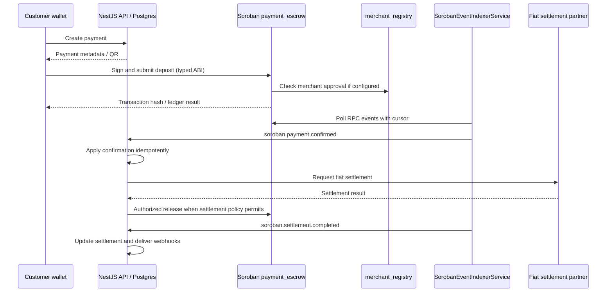

# Soroban integration

The backend coordinates database payments and fiat settlement; contracts in
[dupdapp_stellar](https://github.com/dupdab/dupdapp_stellar) own on-chain escrow.
The ABI source is
[payment_escrow/src/lib.rs](https://github.com/dupdab/dupdapp_stellar/blob/main/dabdub_contracts/contracts/payment_escrow/src/lib.rs).
Pin the contract revision/WASM used by your deployment before changing callers.

## Networks and contract IDs

| Setting                              | Purpose                                                                           |
| ------------------------------------ | --------------------------------------------------------------------------------- |
| `SOROBAN_CONTRACT_ID`                | Contract called by both `StellarService` and `SorobanService`                     |
| `SOROBAN_ESCROW_CONTRACT_ID_TESTNET` | Testnet deployment ID recorded by the contracts deploy script                     |
| `SOROBAN_ESCROW_CONTRACT_ID_MAINNET` | Mainnet deployment ID; never reuse on testnet                                     |
| `SOROBAN_ESCROW_CONTRACT_ID`         | Selected deployment ID; does **not** automatically populate `SOROBAN_CONTRACT_ID` |
| `STELLAR_USDC_CONTRACT_ID`           | SEP-41 token contract monitored for transfer events                               |
| `SOROBAN_TESTNET_CONTRACT_ID`        | Contract used by opt-in integration tests                                         |

Testnet RPC: `https://soroban-testnet.stellar.org`; Horizon:
`https://horizon-testnet.stellar.org`; passphrase:
`Test SDF Network ; September 2015`.
The testnet USDC issuer is `GBBD47IF6LWK7P7MDEVSCWR7DPUWV3NY3DTQEVFL4NAT4AQH3ZLLFLA5`
(an account address, **not** a Soroban contract ID).

The corresponding testnet USDC SEP-41 contract address is
`CBIELTK6YBZJU5UP2WWQEUCYKLPU6AUNZ2BQ4WWFEIE3USCIHMXQDAMA`.
It is derived by `new Asset('USDC', issuer).contractId(Networks.TESTNET)`
using the Stellar SDK. Its contract instance was verified through testnet RPC
`getLedgerEntries` on 2026-10-20 (last modified ledger 4609662). This is a token
contract for transfer-monitor testing, not the escrow contract. Testnet resets
can invalidate deployed instances; check RPC again before integration testing.

Neither repository currently publishes a verified, live testnet escrow/registry/
ledger address. The `CAAAAAAAAAAAAAAAAAAAAAAAAAAAAAAAAAAAAAAAAAAAAAAAAAAAD2KM`
address in backend unit tests is a mock, not a deployed test contract. Do not send
funds to it. Obtain real test addresses by running
`dabdub_contracts/contracts/payment_escrow/scripts/deploy.sh testnet` in the
contracts repository with its documented initialization settings. The script
prints the ID and writes `SOROBAN_ESCROW_CONTRACT_ID_TESTNET` to its backend env
example. Copy that ID to this backend's `SOROBAN_CONTRACT_ID` and integration
test's `SOROBAN_TESTNET_CONTRACT_ID`. Record registry/token IDs from the same
network's initialization inputs. Verify the contract instance and WASM on RPC
before use; redeploy after testnet resets. Keep signer secrets out of docs.

## ABI and XDR

Soroban uses XDR `ScVal`, not JSON arguments. `Env` is implicit. Amounts are
integer base units (`i128`), never floating point. Stellar assets conventionally
use seven decimals. IDs are exactly 32 bytes, not UUID strings. Addresses require
`Address.toScVal()`; use typed `nativeToScVal` conversions for numeric values.

| Escrow method       | Arguments after implicit Env                                                                                        | Return ScVal                    |
| ------------------- | ------------------------------------------------------------------------------------------------------------------- | ------------------------------- |
| `deposit`           | customer: Address, payment_id: BytesN<32>, merchant: Address, amount: i128, ttl_ledgers: u32, asset_type: AssetType | bytes (32-byte payment ID)      |
| `release`           | caller: Address, payment_id: BytesN<32>                                                                             | void                            |
| `release_partial`   | caller: Address, payment_id: BytesN<32>, amount: i128                                                               | void                            |
| `refund` / `expire` | payment_id: BytesN<32>                                                                                              | void                            |
| `dispute`           | caller: Address, payment_id: BytesN<32>, reason: String                                                             | void                            |
| `resolve_dispute`   | caller: Address, payment_id: BytesN<32>, winner: Address                                                            | void                            |
| `get_payment`       | payment_id: BytesN<32>                                                                                              | map of PaymentEscrow fields     |
| `get_balance`       | payment_id: BytesN<32>                                                                                              | i128 remaining escrow balance   |
| `get_expiry`        | payment_id: BytesN<32>                                                                                              | u32 ledger sequence             |
| `get_registry`      | none                                                                                                                | Option<Address> (void for None) |

`AssetType` is a vector containing a symbol (`XLM` or `USDC`). `get_payment`
returns `payment_id`, `amount`, `released_amount`, `merchant`, `customer`,
`status`, `expiry`, `dispute_window_end`, `dispute_reason`, and `asset_type`.
Structs encode as symbol-keyed maps; enum variants encode as vectors. Decode
with `scValToNative`; keep bigint amounts as decimal strings in JSON responses.
Contract errors appear as simulation errors or failed transaction results,
not successful business responses. The registry is configured in escrow to
check merchant approval; there is no direct registry or settlement-ledger ABI
client in this backend today.

### Current backend call patterns and compatibility gaps

`StellarService.invokeContract(fn, args)` simulates, assembles, signs, submits,
and returns a transaction hash on PENDING. A hash is **not** confirmation.
Its current generic conversion uses `nativeToScVal`; callers must ensure the
resulting types match the deployed ABI. `buildAssetTypeScVal` builds the enum.

`SorobanService.invokeContract(options)` supports typed ScVal arguments,
read-only simulation, and write preparation/signing/polling. Read-only responses
contain `{ transaction, simulation, result }`; `result` is decoded from base64
`result.retval`/`result.xdr` or `results[0]`. Writes return
`{ transaction, response }` after polling. RPC SDK objects may also expose
ScVal instances; inspect the SDK response rather than assuming a JSON number.

The convenience methods `registerUser`, `getBalance`, `getStakeBalance`,
`deposit(address, amount)`, `release(id, merchant)`, and `refund(id, customer)`
reflect a legacy ABI. They **do not match** current Rust escrow signatures and
must not be used as evidence of deployed contract compatibility. In particular,
`get_balance` is per payment, not per wallet. `PaymentEscrowService` also holds
an in-memory lifecycle mirror; its `confirm` is not a contract invocation.
ABI migration and persistent reconciliation require separate implementation.

## Payment sequence

The indexer expects `payment_confirmed` and `settlement_completed` payloads
(see `src/stellar/soroban-event.dto.ts`). Match these event schemas against the
deployed contract version; legacy contract events may need an adapter. Separate
SEP-41 transfer monitoring and classic Horizon payments are also supported and
are not equivalent to escrow confirmation. Persisted cursors and transaction/event
IDs prevent replay; retries must check existing payment state before resubmission.
